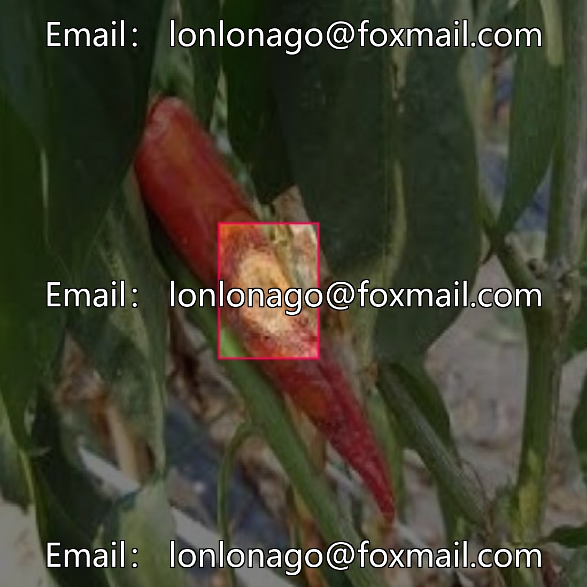
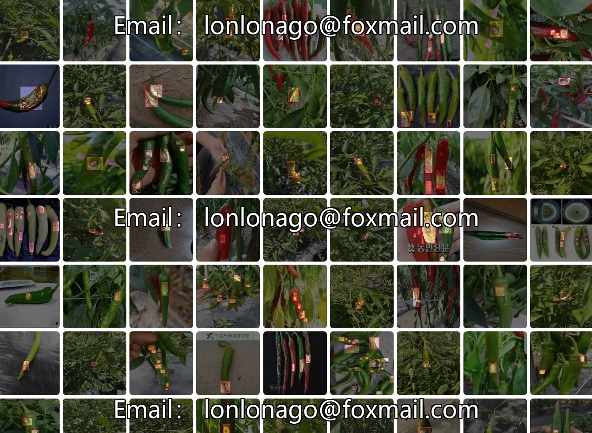
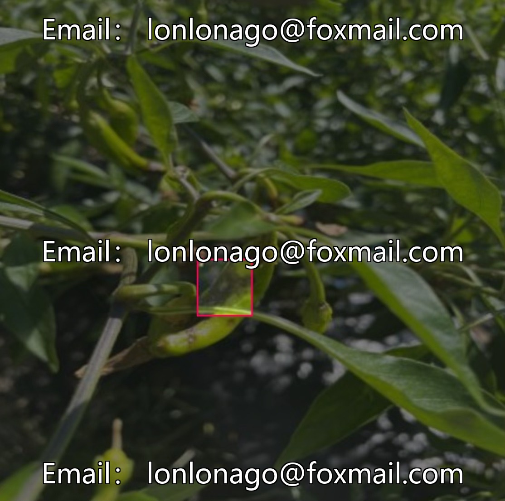
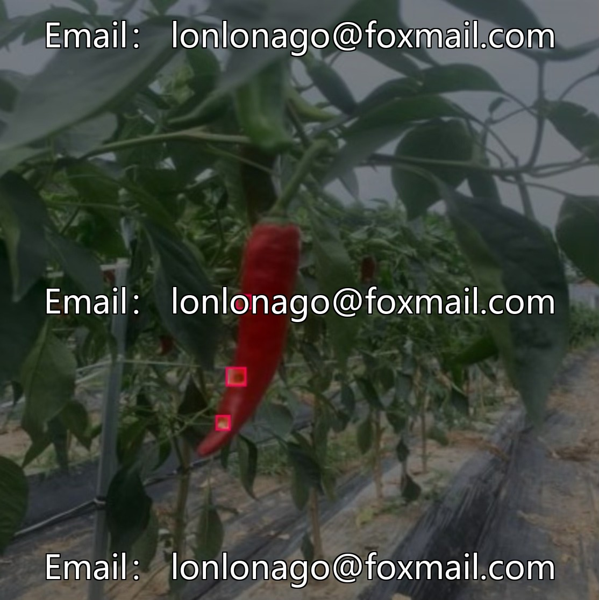
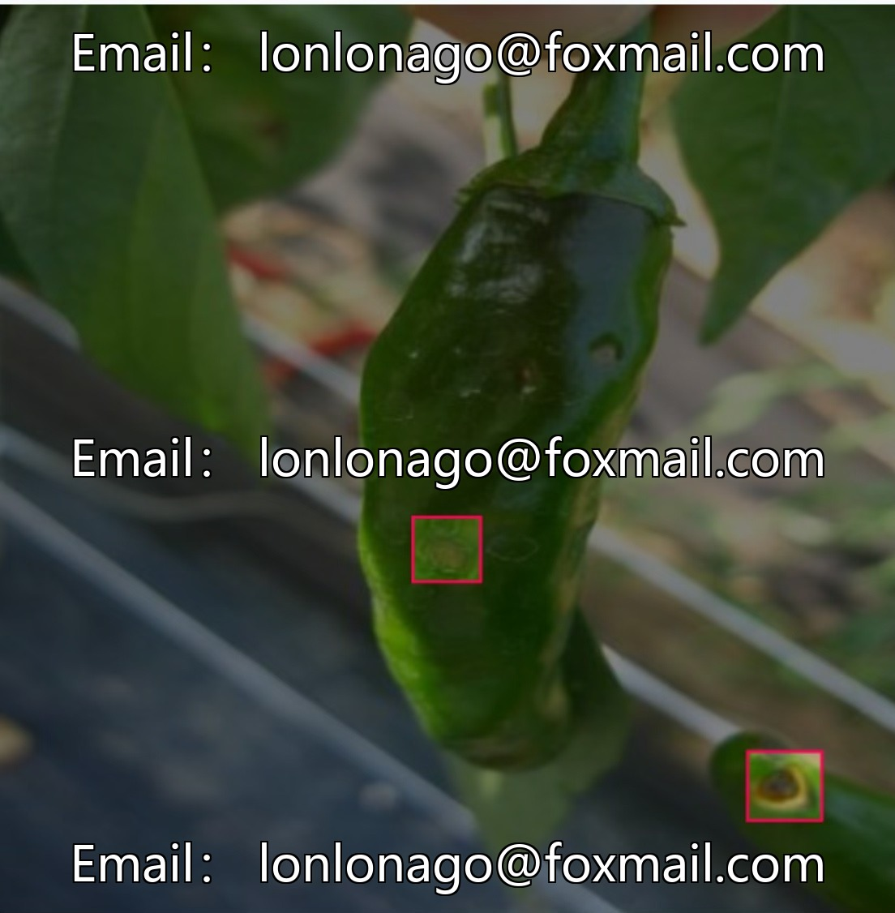
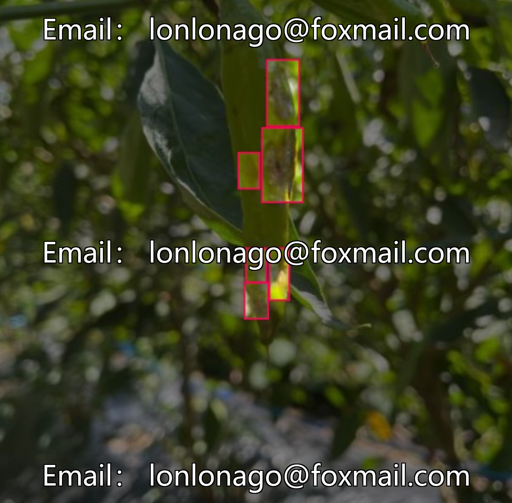

# Intelligent Agriculture Chili Disease Identification Dataset, consisting of 212 images, focusing on chili necrosis.

## Body

Intelligent Agriculture Chili Disease Identification Dataset, comprising 212 images, focuses on the identification of diseases such as chili necrosis and defects, suitable for training computer vision models and instance segmentation tasks.

The data format is an image file, with accompanying annotation information, and supports input by mainstream models. Category is singular, annotation is unified, which facilitates fine-grained learning of models. It is suitable for the development of disease recognition and instance segmentation models in fields such as medical and agricultural sciences.

The data volume is moderate, covering common visual features, suitable for rapid data preprocessing and model iteration. Technology R&D and industry implementation can both be used, providing a data benchmark for single-category instance segmentation tasks.

Virtual materials, once sold, are non-refundable.
Interested friends, click "I want" to proceed.

## Images

## Payment

Here is a pay link on Stripe ( https://buy.stripe.com/3cs8yP7sY87d0vu9AB ). Please contact me lonlonago@foxmail.com after funding $89, and I will send you a complete data files , thank you!

